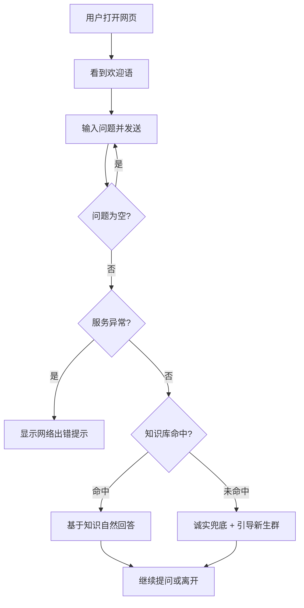

# V0.1 MVP · 泰院 AI 学长

> 单版本 PRD：仅记录 V0.1 的开发任务与落地情况
> 版本状态：✅ 已完成（2026-08-13 上线，含当日迭代）

## 版本核心目标

验证核心价值假设：**「新生问校园问题 → AI 基于校园知识准确回答」这条链路能不能跑通**。承接项目总目标的"答得了、答得准"部分。不追求用户规模，只追求链路完整与回答可信。

**明确不做**（本期边界）：账号系统、校园群机器人接入、复杂工具调用、多校区支持、RAG 向量检索（先用关键词匹配）。

## 版本用户旅程



## 用户故事

### US-V01-01 新生提问（UI 故事）

**业务逻辑**：用户打开网页即进入对话界面，顶部固定标题"🎓 泰院 AI 学长"，初始显示欢迎语气泡。输入框支持回车与按钮两种发送方式；发送期间按钮禁用并显示"学长正在输入…"；空输入不触发发送；服务异常时在对话流中显示"网络出错了"提示，页面不崩溃。

**界面线框图**（ASCII Wireframe）：

```
┌─────────────────────────────────────┐
│          🎓 泰院 AI 学长              │ ← 顶部固定标题栏（白底、居中、投影）
├─────────────────────────────────────┤
│ [🎓] 你好呀，我是泰院 AI 学长！      │ ← 欢迎语（左侧白气泡）
│      报到、宿舍、选课、资助……         │
│                                     │
│              报到要带什么证件？        │ ← 用户消息（右侧绿气泡 #07c160）
│ [🎓] 需要带：①录取通知书（原件）；   │ ← AI 回复（左侧白气泡，圆角）
│      ②身份证及复印件……              │
│                                     │
├─────────────────────────────────────┤
│ [想问点什么？比如：助学贷款怎么申请]  │ [发送] │ ← 底部固定输入栏
└─────────────────────────────────────┘
```

移动端优先：气泡最大宽度 78%，输入栏固定底部，消息自动滚动到底。

**验收标准**：
- [x] 打开页面 2 秒内显示标题栏与欢迎语
- [x] 发送非空问题后，输入框清空、按钮禁用、"学长正在输入…"出现
- [x] 收到回复后提示消失、按钮恢复、对话流自动滚到最新消息
- [x] 空输入回车/点击发送不产生任何请求
- [x] 服务异常时显示"网络出错了，稍后再试"，可继续输入重试，页面不白屏
- [x] 手机与电脑浏览器均可用（实测通过）

### US-V01-02 知识库命中回答

**业务逻辑**：用户问题命中 FAQ 条目（关键词检索，疑问泛词降权、必须有实词命中）时，将条目内容注入模型指令，模型以学长口吻自然回答：不提"知识库""校园知识""根据资料"等词，不整段复述条目原文；条目未覆盖的细节单独说明"这块还没整理到"并给建议，其余部分照常回答。

**验收标准**：
- [x] 命中条目的问题，回答与该条目内容一致（抽查：助学贷款、期末考试时间等）
- [x] 回答全文不出现"知识库""根据校园知识"等机械话术
- [x] 不编造条目答案之外的泰山学院具体信息
- [x] 部分覆盖场景（如"家长开车进校"命中"家长进校"条目）：未覆盖点单独说明+给建议，已覆盖点照常回答

### US-V01-03 未命中诚实兜底

**业务逻辑**：问题没有命中任何 FAQ 条目时，模型以学长口吻自然说明暂时答不上来，建议到新生群问学长学姐；禁止编造泰山学院具体信息。

**验收标准**：
- [x] 未命中问题的回答包含"暂时答不上来"语义 + 新生群人工建议（抽查：保研率、就业率等）
- [x] 回答不含编造的泰山学院具体数据
- [x] 未命中不阻断对话，用户可继续提问

### US-V01-04 多轮对话上下文

**业务逻辑**：会话历史按顺序保留并随每次请求发送，模型可引用上文（如先问"军训"，再问"那要多久"能接住语境）。

**验收标准**：
- [x] 追问能接住上一句主题（如"助学贷款怎么申请"→"那什么时候还"）
- [x] 历史消息在多次交互间不丢失

## 异常/边界约束

| 场景 | 处理 |
|---|---|
| 请求体编码错误（非 UTF-8） | 返回 400，服务不崩溃（2026-08-13 实测触发并修复） |
| 模型接口超时/失败 | 前端显示"网络出错"，后端返回 500，服务继续可用 |
| 问题命中多个条目 | 取关键词得分最高者；纯泛词命中（得分不足）视为未命中 |
| 超长对话历史 | 当前未做截断（V2 考虑），MVP 场景会话长度可控 |

## 落地差异说明（与原规划的差异）

1. **上线当天迭代一轮（v1.1）**：内测自测发现两个问题——检索错配（泛词"什么时候"抢分导致"军训"问题错答成报到）、回答语气机械（"根据校园知识……我不知道"话术）——当日完成修复并回归测试通过。
2. FAQ 内容中约 20 条泰山学院特有信息标【需核对】，上线时未完成真实信息替换，V1 前必须补完（影响回答准确性底线）。
