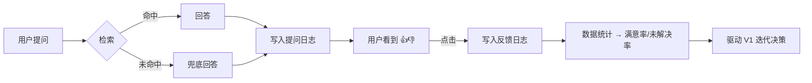

# V0.2 评估体系 · 泰院 AI 学长

> 单版本 PRD：仅记录 V0.2 的开发任务与落地情况
> 版本状态：✅ 已完成（2026-08-14 上线）

## 版本核心目标

让产品**可被评估**：回答"这个产品到底好不好"必须有数据支撑，不能靠感觉。承接项目总目标中的核心指标（提问数、满意率、未解决率）。本期不做用户规模，只做数据闭环。

## 版本核心流程

## 用户故事

### US-V02-01 提问留痕

**业务逻辑**：每次问答自动记录到 `logs/chat_log.jsonl`（JSON Lines，一行一条），字段：时间、用户问题、命中条目 id（未命中记 null）、回答前 200 字。记录行为不影响回复响应。

**验收标准**：
- [x] 每次提问后 chat_log.jsonl 追加一行，字段完整
- [x] 命中时 hit_id 为对应条目 id，未命中为 null（实测：命中条目 9 记录正确）
- [x] 日志写入失败不影响用户正常收到回答

### US-V02-02 满意度评价

**业务逻辑**：每条 AI 回答下方显示「👍 有帮助」「👎 没帮助」按钮；点击后两个按钮同时禁用、被点按钮变色（绿/红），同时记录 {时间、评价、关联的用户问题} 到 `logs/feedback_log.jsonl`；网络异常时评价记录失败不影响使用；错误回复（"网络出错"）不显示评价按钮。

**验收标准**：
- [x] AI 回答下出现两个评价按钮（实测通过）
- [x] 点击后按钮禁用变色，不重复记录
- [x] 反馈日志正确记录 rating 与问题（实测 up 记录成功）
- [x] 错误提示消息不显示评价按钮

## 数据口径定义（供 V1 统计使用）

| 指标 | 计算方式 | 数据源 |
|---|---|---|
| 提问数 | chat_log.jsonl 行数 | 提问日志 |
| 未解决率 | 未命中提问数（hit_id=null）/ 总提问数 | 提问日志 |
| 回答满意率 | 反馈 up 数 / 反馈总数（up+down） | 反馈日志 |
| 使用用户数 | 暂不可精确统计（无账号体系），V1 以推广触达人数替代或加设备标识 | - |

**已知局限**：反馈与具体问答不关联（按整体满意率统计）；无用户去重（用户数无法精确计算）——已在总集未决事项中登记，V1 决策是否升级。

## 异常/边界约束

| 场景 | 处理 |
|---|---|
| 日志目录不存在 | 首次写入自动创建 logs/ 目录 |
| 反馈请求体损坏 | 返回 400，不崩溃 |
| 用户连续点击评价 | 点击后即禁用，天然防重复 |
| 评价请求网络失败 | 前端静默忽略，不打扰用户 |

## 落地差异说明

无。按规划实现。
