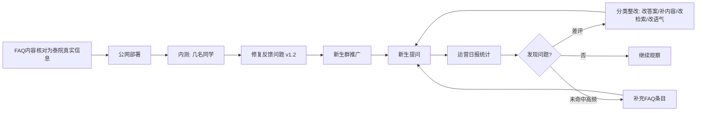

# V1 开学季正式版 · 泰院 AI 学长

> 单版本 PRD：V1 的开发与运营任务
> 版本状态：✅ 已完成（2026-09-14 收尾）

## 最终数据（2026-09-14）

| 指标 | 目标 | 实际 | 达成 |
|---|---|---|---|
| 提问总数 | ≥100 | 128 | ✅ |
| 知识库命中率 | — | 79% | — |
| 未解决率 | <30% | 21% | ✅ |
| 回答满意率 | ≥70% | 59% | ✗（差 11pp） |
| 知识库条目 | — | 70 条 | — |

## 版本核心目标

**2026-08-31 前达成核心指标**：使用用户 ≥ 30、提问数 ≥ 100、回答满意率 ≥ 70%、未解决率 < 30%。

承接关系：V0.1 验证了"答得了"（链路跑通），V0.2 建立了"可评估"（数据闭环），V1 解决"**有人用**"——把产品推给真实新生，用数据驱动内容与体验迭代。

**明确不做**（本期边界）：账号系统、用户去重统计、问答级满意度关联、RAG 向量检索、群机器人接入（列入 V2）。

## 版本核心流程

## 用户故事

### US-V1-01 公网访问（部署）

**业务逻辑**：用户无需安装任何软件，通过一个链接即可访问。内测期用内网穿透（免费、5 分钟上线、依赖电脑在线）；正式推广前切腾讯云学生服务器（7×24 在线、不依赖个人电脑）。

**验收标准**：
- [x] 内测期：生成公网链接，他人手机可访问并正常问答（cpolar 穿透，9.6 已推广验证）
- [ ] 正式推广前：服务部署到云服务器，电脑关机后链接仍可用（未做——已用 cpolar 直接推广，云服务器切换顺延）
- [ ] 部署切换时提问与反馈日志不中断、不丢失

### US-V1-02 FAQ 内容核对（质量底线）

**业务逻辑**：将 FAQ 中约 20 条标【需核对】的内容替换为泰山学院真实信息（来源：学校官网、入学须知、新生群、亲历），并把用户测试发现的缺口问题（参军入伍、上课地点等）补成新条目。原则：知识库零编造，每条答案有据可查。

**验收标准**：
- [x] 44 条中原有【需核对】标记全部清除（9.6 完成；落地决策：改为"通用标准填充 + 保留以学校通知为准表述"，速度优先，精准化按数据反馈迭代）
- [x] 新增缺口条目 ≥ 3 条（实际新增 15 条：参军入伍、保研率、上课地点、选课入口 + 差评整改 11 条，现共 59 条）
- [x] 每条答案能说出信息来源（政策类条目经官方信息核实；通用类以"学校通知为准"兜底）

### US-V1-03 运营数据闭环

**业务逻辑**：运营日报（app/stats.py）每日/每两日跑一次，输出四块看板（总览、差评清单、未命中排行、热门排行）。差评按四类整改：答错→改答案、答不全→补内容、答非所问→改检索词、语气差→改 prompt；未命中高频问题→补 FAQ 条目。

**验收标准**：
- [x] 差评与日报数据合并形成整改清单，至少完成一轮整改（9.6 v1.2：7 处检索错配修复 + 11 条新知识 + 17 条回归测试全过）
- [ ] 推广期每周至少跑 2 次日报，有记录（持续进行中）
- [ ] 数据四指标达标：用户 ≥30、提问 ≥100、满意率 ≥70%（现状 9.6：提问 51、满意率 52%，继续迭代中）

## 里程碑

| 时间 | 里程碑 | 产出 |
|---|---|---|
| 9.6 | FAQ 核对完成 | faq.json 零【需核对】（通用版）+ 缺口条目 |
| 8.14 | 内网穿透部署 | 公网链接可访问（cpolar） |
| 9.6 | 推广（跳过内测阶段，直接新生群） | 提问 13→51 条，反馈 40 条 |
| 9.6 | 第一轮数据迭代（v1.2） | 7 处检索修复 + 11 条新知识 + 回归测试 |
| 持续 | 日报跟踪 | 每周 ≥2 次 stats.py，整改按差评清单迭代 |
| 待定 | 数据达标 | 四指标：用户≥30/提问≥100/满意率≥70% |

## 风险与对策

| 风险 | 对策 |
|---|---|
| 新生群进不去 / 入群失败 | 备选渠道：表白墙投稿、贴吧、QQ 空间、让同学拉群 |
| 电脑关机导致内测链接失效 | 内测期人少可控；正式推广前切云服务器解决 |
| 用户时间被其他事占用（课业/考试同期进行） | FAQ 核对分解为每天 30 分钟小任务；机械化的工作尽量交给 Claude 代劳 |
| 推广后无响应 | 降低期望：数据不达标也照常收尾，如实记录真实数字 |

## 内测引导文案（随时可用）

> 我做了个咱学校的新生问答助手「泰院 AI 学长」，报到、宿舍、选课、资助这些都能问。帮我测测呗？答得不对的或者问不到的，直接点下面的 👍👎，或者回来告诉我。链接：http://【公网地址】

## 落地差异说明（与原规划的差异，2026-09-06 更新）

1. **内测与推广合并**：开学季窗口期优先，直接推广到新生群，靠差评反馈闭环补偿试错
2. **FAQ 核对策略变更**：由"逐条核对泰院真实信息"改为"通用标准填充 + 以学校通知为准兜底"，速度优先；政策类条目（入党/普通话/学生票）经官方信息核实
3. **数据指标时点顺延**：原定 8.31 盘点，后顺延至 9 月开学季窗口
4. **启动方式固化**：新增 启动.bat 双击启动（服务不再依赖开发会话）；踩坑：中文编码+引号嵌套导致闪退，已重写为纯 ASCII 版
5. 项目复盘见 [../项目复盘.md](../项目复盘.md)
